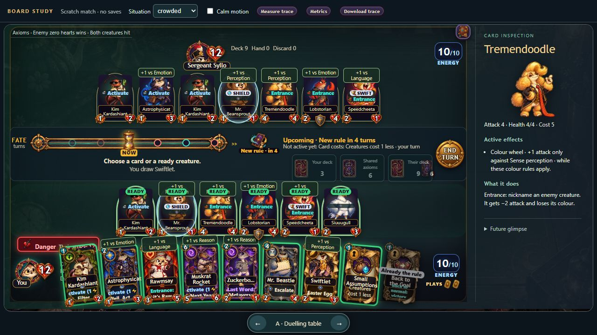
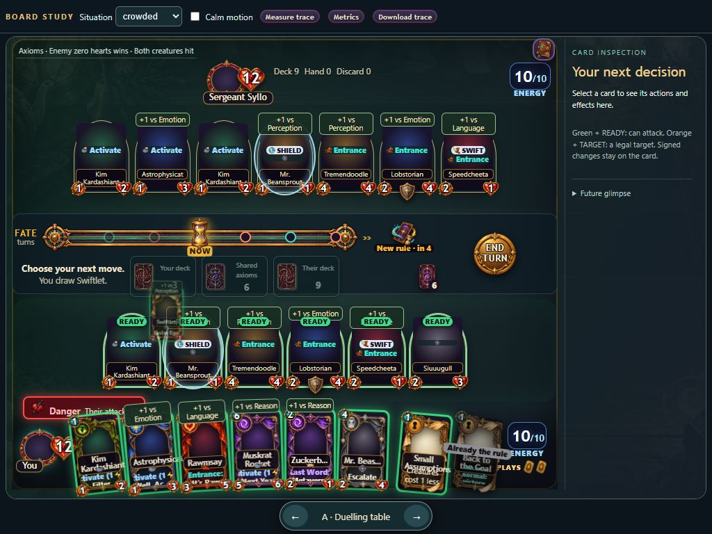
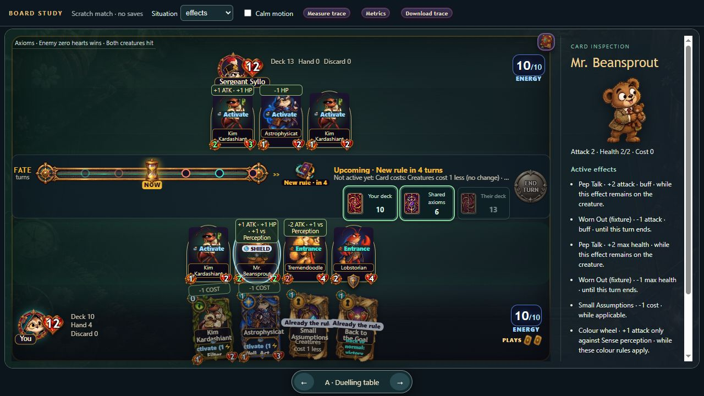
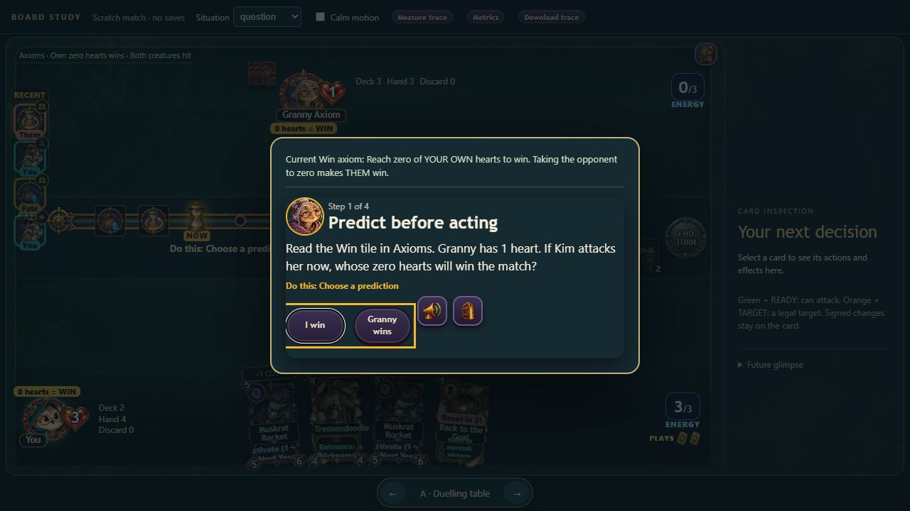

# Playable Card Arena layout study — 12 October 2026

Ready for teacher layout review under #107, with reference and measurement evidence for #106. These are disposable development matches on Rift's actual battle screen and engine. The production game has not been switched to a new layout.

## Try the layouts

| Layout | Playable study | Reason to choose it | Tradeoff |
|---|---|---|---|
| **A — Duelling table (recommended)** | [Open A](https://rktrobinhood.github.io/TOK-Materials/AOK/Mathematics/Rift%20of%20Reason/dev/battle.html?prototype=1&variant=A&fixture=normal&seed=board-study-107) | Compact board portraits leave the battlefield visible. Complete card text and Active effects have a right-hand inspector. | Small portraits favour inspection. Crowded hand text remains dense. |
| B — Command board | [Open B](https://rktrobinhood.github.io/TOK-Materials/AOK/Mathematics/Rift%20of%20Reason/dev/battle.html?prototype=1&variant=B&fixture=normal&seed=board-study-107) | A vertical hand library stays separate from the battlefield. | Scrolling and narrow hand cards cost time and readability on smaller laptops. |
| C — Study desk | [Open C](https://rktrobinhood.github.io/TOK-Materials/AOK/Mathematics/Rift%20of%20Reason/dev/battle.html?prototype=1&variant=C&fixture=normal&seed=board-study-107) | A broad left inspector favours reading. Fate/actions sit below both boards. | Less horizontal battlefield space; crowded cards are smaller. |

Bottom arrows switch layouts without restarting. **Situation** offers normal, crowded (six own/seven enemy creatures and eight opening hand cards), effects, required-question, short-lesson and full-lesson fixtures. Drawing in the crowded fixture produces nine hand cards. These prepared examples never write student progress. The ordinary bench still works without `prototype=1`.

Select a glowing deck, select/play a hand card, select a ready creature and a legal target, activate Kim's Filter, play an axiom, then End turn. Axioms opens the actual rules/log panel. Inspection responds to pointer, click and keyboard focus. Future glimpse is a collapsible reservation for #108's outcome clips; it does not simulate hidden draws.

## Screenshots

[B crowded](board-traces-2026-10-12/B-crowded.jpg), [B laptop](board-traces-2026-10-12/B-laptop.jpg), [C crowded](board-traces-2026-10-12/C-crowded.jpg).

## Verified behaviour

- All retained traces completed real draw, play, attack/defeat, Filter, axiom change and End turn/Fate. No action was skipped; committed events include attack and defeat, respecting Guard in the crowded fixture.
- Manually drew from the visible deck, dragged Kim from hand to board, and selected Tremendoodle/clicked a legal enemy to resolve combat. Keyboard draw/card selection also worked. Fixed an adapter bug that could remove the focused deck button during inspection.
- Viewed A/B/C at 1280×720 and 1024×768. Refined spacing and separated READY labels from modifiers. A's nine-card laptop hand leaves energy visible. Inspections scroll instead of enlarging cards over targets. Physical touch/mobile layouts remain unverified.
- Effects use `Engine.describe/attackParts`. Beansprout shows stacked +2/-1 attack and max-health changes, cost axiom, source/duration explanations and target-dependent colour bonus. Illustrative temporary buffs are labelled “fixture”.
- Required questions use the actual coach/answer handlers in a native modal. Wrong answers give real feedback; Escape does not advance. Correct prediction advances to the independent experiment. The current Win axiom is readable inside the modal; ongoing guidance stays beside the board. Short/full entries load real lesson sources; complete walkthroughs remain for integration QA.
- Calm motion uses an opacity draw cue and existing battle treatments. No console errors observed in checked states or ordinary bench. Scratch State hooks intercept save/statistic writes; production State is unchanged.
- Final `node --test "tools/test/*.test.mjs"`: **804 passed, one skipped, zero failed** (805 total). `node --check dev/arena-prototype.js` passed.

## Desktop measurements

Fixed seed `board-study-107`, 1280×720, warmed images. Desktop: i7-6700, 16 GiB RAM, RX 580, Chromium 154. Times in milliseconds. Input max is the maximum of ten synthetic click-to-first-DOM-feedback samples, not physical input-to-displayed-pixel latency.

| Capture / raw JSON | Frame p95 | Frame p99 | Worst | Frames >33.34 / >50 | Input max |
|---|---:|---:|---:|---:|---:|
| [Current, normal](board-traces-2026-10-12/baseline-normal-normal.json) | 18.2 | 35.2 | 36.1 | 5 / 0 | 47.6 |
| [Current, crowded](board-traces-2026-10-12/baseline-crowded-normal.json) | 18.1 | 42.6 | 72.0 | 9 / 4 | 51.8 |
| [Current, crowded Calm](board-traces-2026-10-12/baseline-crowded-calm.json) | 18.2 | 36.0 | 54.2 | 9 / 3 | 46.0 |
| [A, normal](board-traces-2026-10-12/A-normal-normal.json) | 16.8 | 16.9 | 50.0 | 3 / 0 | 37.1 |
| [A, crowded Calm](board-traces-2026-10-12/A-crowded-calm.json) | 16.8 | 33.3 | **100.3** | 4 / 3 | 30.4 |

Single-run observations establish a repeatable local baseline, **not a performance improvement claim**. Captures were taken at different times with different observed frame cadence. A still has slow frames. Every original card node was gone after each recorded action/selection: rearrangement retains the production renderer's rebuild problem.

Raw JSON includes long-animation-frame blocking/render/style-layout data and action coverage. It is not a complete DevTools paint breakdown or continuous-drag benchmark. See [reference audit](board-reference-audit-2026-10-12.md) for licence, motion inventory, limits and provisional integration budgets. #106 remains open for representative school-laptop profiling and fuller layout/paint evidence.

## Teacher decision and remaining checks

**Carry A into production, or prefer B/C?** #107 explicitly requires teacher feedback and a settled layout before replacement. No redesign issue is closed by this study.

#109 should port only the selected structure, preserve keyed hand/board nodes and keyboard focus, synchronize stats/effect explanations, and coordinate a cancellable queue with #66. #108 owns actual future clips; #103 owns production required-question behaviour.

Before production acceptance: real browser zoom, representative laptop/physical touch, complete short/full lessons, saved encounters and Chapter 4 action flows. Browser policy blocked `file://` navigation, so offline interactive play could not be verified here. The study uses classic scripts/local assets with no new fetch/module/build dependency. #110 remains the school-playtest stage.
