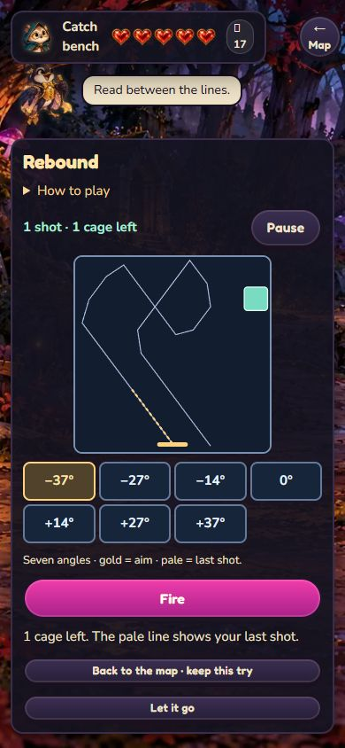

# Three production catch games — #158, 18 October 2026

The teacher asked to finalize the three-game catch system. This authorizes the campaign integration beyond the earlier isolated prototype. Pocket Nets, Rebound and Trail Finder now replace the ring/old grid in the adventure. The remaining human task is judging classroom pace, enjoyment and success rate.

## Delivered behaviour

- One uniformly seeded random game per attempt, committed with the visitor before payment. A failed attempt offers a new selection; reloading does not reroll it.
- Winning the visible game grants the creature directly. There is no post-win catch probability roll. Randomness supplies game choice, layout and cosmetic foil/variation.
- One charm pays for the entire attempt, charged on Start after untimed instructions. Great Charm and lure each add one cast, shot or trap heart. Fox adds one for Language/Imagination creatures. Help preserves the same admitted layout.
- Native buttons support keyboard, mouse and touch. Nets preview the selected cut; Rebound uses seven finite bank-shot angles; Trail Finder offers touch flag mode and F/arrow controls. All paths are static under normal, Calm and OS reduced-motion settings. Pause and reading spend no moves.
- `catchOffers` is canonical save data. It carries the visitor, attempt, selected game, paid item, full board, version and settlement receipt through reload and backup codes. Returning to the node resumes catching without another visit roll, puzzle reward or charm charge.
- Each accepted layout has a replayable unassisted winning certificate. Trail Finder admission uses visible-clue direct/subset deductions and the total trap count, without guessing. Net rarity uses the same terrain and seeded behaviour at every tier; easier tiers add casts rather than admitting harder boards.
- Charges, legal moves, collection changes and receipts are published after one successful storage write. Failed writes do not advance the board or grant creatures. Collection capacity is checked before payment and on settlement; a winning attempt whose folder fills returns its charm.
- Optimistic checks detect a changed save before and after computation. A detected conflict blocks mutations and shows a required reload notice. This is not cross-process compare-and-swap: truly simultaneous separate-process writers remain unsupported. Use one active tab per adventure.

## Rarity settings

| Rarity | Pocket Nets | Rebound | Trail Finder |
|---|---|---|---|
| Common | 6 casts | 5 shots, 3 cages | 4×4, 2 traps |
| Uncommon | 5 casts | 4 shots, 4 cages | 4×4, 3 traps |
| Rare | 4 casts | 3 shots, 5 cages | 5×5, 4 traps |
| Legendary | 3 casts | 3 shots, 6 cages | 5×5, 6 traps |

Nets choose steady/turner/hunter through a separate seeded stream. Their goals are three tiles (steady/turner) or four (hunter). Trail Finder starts with one trap heart; these are game lives, not adventure health.

## Evidence

`node tools/sim-catch-games.mjs 200 design/reviews/catch-games-158-2026-10-18.json` checks 200 held-out seeds per game/rarity: 2,400 certified boards. The adjacent JSON records every result, assistance comparison, certificate length and exact policy definition. Net and Rebound policies have only one action of lookahead; the deduction policy is a logical expert. Random policies select legal actions uniformly. No deliberate-loss coin flip is used to manufacture a 50% result.

| Game | Rarity | Documented policy | Random policy | Policy + both helps | Median certificate actions |
|---|---|---:|---:|---:|---:|
| Pocket Nets | common | 73.5% | 14.5% | 73.5% | 3 |
| Pocket Nets | uncommon | 71.5% | 8.5% | 73.5% | 3 |
| Pocket Nets | rare | 62.5% | 7.5% | 73.5% | 3 |
| Pocket Nets | legendary | 49.5% | 3% | 71.5% | 3 |
| Rebound | common | 100% | 44% | 100% | 2 |
| Rebound | uncommon | 100% | 22% | 100% | 3 |
| Rebound | rare | 84.5% | 7% | 100% | 3 |
| Rebound | legendary | 68.5% | 4% | 99% | 3 |
| Trail Finder | common | 100% | 12% | 100% | 5 |
| Trail Finder | uncommon | 100% | 5.5% | 100% | 8 |
| Trail Finder | rare | 100% | 2% | 100% | 10 |
| Trail Finder | legendary | 100% | 1% | 100% | 14 |

These machine rates establish neither average-student success nor enjoyment. In particular, a no-guess logical expert is expected to win every deduction board. The original prototype's 48.07% figure must not be presented as the production set's human rate. Approximately 50% student success and 20–60-second play are classroom targets still to measure.

Full repository-owned suite: **1,122 tests; 1,121 pass, one existing skip, zero failures**, 201.4 seconds, with `--max-old-space-size=2048 --test --test-concurrency=2` and the tracked test list including the new tests. Final compact UI/encounter/hunt checks also pass 41/41. Pre-existing untracked Mending tests and OneDrive sync copies were preserved and excluded, as recorded in the issue-loop checkpoint; no green claim is made for those unfinished files.

Focused coverage includes certificate replay at every supported rarity, deterministic choice, assistance preserving wins, paired net difficulty, untimed reading, pause/destroy guards, touch flags, keyboard focus, actual encounter reloads, backup receipts, duplicate starts/settlements, storage failures during final rewards, conflicts during admission, stale autosaves, the required conflict modal, copy caps, Fox assistance and unchanged adventure health. The hunt test adapter now retains one storage Map and verifies an actual mid-run reload.

Browser checks completed all three games, keyboard wins, Calm phone controls and no horizontal overflow. A separate adventure bench reuses the production document/load order with namespaced test storage. Its paid Rebound try changed the bag from 18 to 17, resumed after reload with the same board, won, then retained the same creature stats and bag count after another reload. Container queries use the actual panel width; at phone width the compact host, board and action controls remain visible. Final board inspection remains available after an escape.

## Standards

Independent final review: no actionable Standards or correctness findings remain. The earlier findings about optimistic conflict handling and silent stale-tab progress were fixed or explicitly limited as described above. Container sizing, native control targets, untimed collapsible instructions and paired rarity coverage were checked. No additional documented violations or warranted baseline smells were reported.

## Spec

Independent final review: no actionable Spec findings. Three distinct random games, rarity settings, direct skill settlement, feasibility, input/motion support, persisted charges and rewards, and capacity protections are implemented. Production integration is now explicitly authorized. Student success rate, duration and enjoyment remain classroom evidence gaps.

## Teacher playtest

Open [the practice room](../../dev/catch-games.html). It spends no charms and does not touch the adventure save. Play each game once at common and rare, then repeat an identical seed with a Great Charm and lure. Record game, rarity, help, success, seconds, whether a loss was understandable, and whether another try felt appealing. Use those observations to tune budgets and clue density; do not hide a weak game inside an overall average.

The production fixture is `dev/catch-adventure.html?kind=net|ricochet|tracks&calm=1` (HTTP required); its storage keys are separate from player saves. `fresh=1` explicitly resets that test save on each load, so omit it when checking reload persistence.

