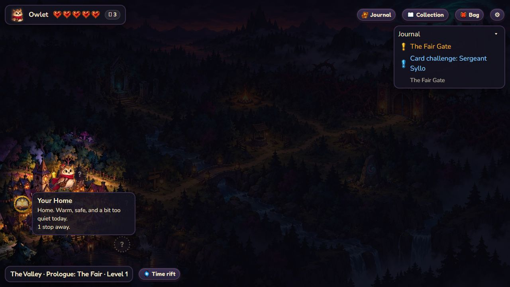
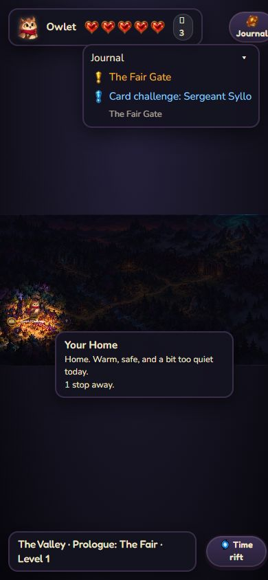

# Map visual follow-up — #163, 24 October 2026

Screenshot capture recovered during the 05:53 UTC wake. This records the shipped map route preview (ff42409) and idle integration (1ddcf6d) on unchanged main. It supersedes the earlier reports' unavailable-screenshot limit for the views captured here, not their broader device/art limits. No runtime, image asset, save schema, model or voice change.

## Native checks

Windows in-app Chromium, real production Continue route at localhost:8791, existing Owlet-boy adventure at the Fair Gate. Actual viewports measured **1280×720** and **390×844**. Desktop screenshots show the avatar within its cell, its ground/shadow alignment and the Home route tooltip. Native Tab focuses Home, displays “1 stop away” and highlights its route. The gold route has a solid 7px stroke and no CSS animation.

Normal-motion observations sampled idle offsets 1070 and 1498, with the map position fixed at `translate(200,600)`. Calm was enabled through the real checkbox; later desktop and narrow observations both held `0 0 214 240`. Screenshot comparisons reveal no clipping of this selected avatar or overlap between the desktop Home tooltip and HUD. These are sampled live frames, not a recording of a complete smooth loop. Native inspection covers Owlet only; the mounted checks cover the other nine manifests and the full cycle. Physical touch, other browsers/devices and live OS preference changes remain untested here.

## Narrow viewport finding — #159

At actual 390px, the tooltip remains readable, but the entire map is scaled small. The HUD's Journal extends to x402, Collection x500, Bag x559 and Settings x606; the viewport ends at x390. The page's reported content width is also390, so **no horizontal overflow does not mean the controls fit**. The screenshot visibly clips Journal and excludes the three following controls. The in-map Journal tracker remains visible. This supports the already reported phone usability work in #159. Its explicit stretch/tracking-only priority is preserved; this evidence follow-up does not implement that work or claim mobile acceptance.

## Save and cleanup

Fresh Settings exports before/after normal playback and route inspection match exactly. After restoring Calm off with a checkbox click, a fresh Settings screen confirms it off and its export again matches: **2,089 characters**, SHA-256 `da39d3f170a2a3515e51d30623fc63978b4c2781e930125c721d7b692a2d6b9d`. No travel, rewards, Copy/Download or backup import. Raw codes are omitted. Viewport override reset, original background visibility restored, temporary tab13 closed. Receipts and five native PNGs are in `map-visual-163-2026-10-24/`.

All **27 focused asset-grid, modal/map and hunt-UI checks pass**, 1422.3615ms. No runtime changed, so the full-suite result remains the previously recorded integration run: 1,512 total / 1,511 passed / 1 existing skip / 0 failures. No new full-suite or independent code-review run is claimed for this evidence-only change.

**#163 remains open** for broader asset/frame/sprite work and acceptance. The narrow HUD finding remains under deferred #159. External art/expansion work, original OneDrive checkout and voice quota ledger are untouched.
